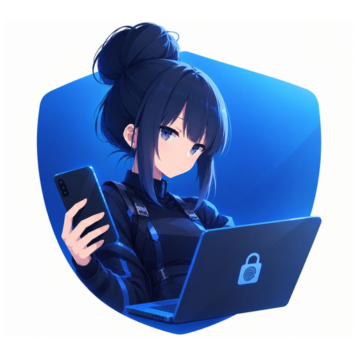

<p align="center">
  
</p>

<h1 align="center">🔐 Portal-Android 🔐</h1>
<h3 align="center">✨ Кодовое имя: <em>Camelia.2</em> (v2.4.0 / Code 53) ✨</h3>

<p align="center">
  <b>Умный, безопасный и мгновенный беспроводной ключ для ПК на Android и Wear OS</b><br>
  <i>Smart, secure, and instantaneous wireless PC unlocker for Android and Wear OS</i>
</p>

<p align="center">
  <a href="https://github.com/KoksMen/Portal-Android/releases/latest"></a>
  
  
  <a href="https://play.google.com/store/apps/details?id=com.xxmrk888ytxx.portal"></a>
  <a href="LICENSE"></a>
</p>

<p align="center">
  <a href="#-portal-android-на-русском"><b>🇷🇺 Перейти к русской версии</b></a> &nbsp;|&nbsp; 
  <a href="#-portal-android-in-english"><b>🇬🇧 Switch to English Version</b></a>
</p>

---

## 📲 Загрузка и ссылки / Downloads & Links

| Платформа / Platform | Источник / Source | Ссылка / Link |
|:--------------------:|:-----------------:|:-------------:|
| **Android & Wear OS (APK)** | GitHub Releases | [📥 Скачать последний APK (Camelia.2)](https://github.com/KoksMen/Portal-Android/releases/latest) |
| **Android & Wear OS** | Google Play Store | [🏪 Открыть в Google Play](https://play.google.com/store/apps/details?id=com.xxmrk888ytxx.portal) |
| **PC Client (Windows)** | GitHub Releases | [💻 Скачать Portal-Windows](https://github.com/KoksMen/Portal-Windows/releases) |

---

# 🇷🇺 Portal-Android (на русском)

**Portal** — это полностью **бесплатный** и **открытый (open-source)** беспроводной умный ключ, превращающий ваш Android-смартфон и смарт-часы на базе Wear OS в инструмент для мгновенной, удобной и защищенной разблокировки вашего компьютера. Никакой рекламы, никаких облачных серверов, скрытых подписок или телеметрии.

> [!IMPORTANT]
> Для работы приложения необходимо установить Windows-клиент на ваш ПК: [**Portal-Windows**](https://github.com/KoksMen/Portal-Windows/releases).

---

## ✨ Что нового в версии Camelia.2

- **🎨 Строгий минимализм Material 3 (по дизайн-системе Stitch / Google Pixel):**
  - Полностью переработана визуальная иерархия всех ключевых экранов в соответствии с принципами чистоты интерфейса Google Pixel: лаконичные отступы, адаптивные карточки, современные закругления и отсутствие визуального шума.
- **✨ Переработанный экран добавления устройства («Add Device»):**
  - Интуитивные интерактивные карточки выбора протокола (**Wi-Fi / Локальная сеть** с бейджем «Рекомендуется» и **Bluetooth**).
  - Быстрое сканирование через QR-код с экрана монитора в один тап.
  - Аккуратные сгруппированные поля ввода с понятными подсказками и моментальным списком обнаруженных Bluetooth-устройств.
- **⚙️ Умная конфигурация устройства («Device Settings»):**
  - **Контекстное разделение протоколов:** для Bluetooth-подключений скрыты неиспользуемые блоки mTLS сертификатов и хэшей, а заголовки автоматически адаптируются («Настройки Bluetooth»).
  - Для Wi-Fi подключений добавлена удобная кнопка **«Инфо»** с детальным модальным окном параметров (UUID устройства, хэши сертификатов клиента и сервера) и поддержкой копирования в один клик.
- **🔓 Новый эргономичный экран подтверждения разблокировки («Unlock Request»):**
  - Крупное и выразительное имя разблокируемого компьютера по центру экрана (`34sp`).
  - Эргономично приподнятый макет для максимально удобного подтверждения одной рукой.
  - Информативный динамический бейдж с указанием типа подключения (**Wi-Fi** или **Bluetooth**).

---

## 🚀 Режимы работы

1. **Разблокировка со смартфона:** Ручной запуск разблокировки компьютера из списка сохраненных устройств или через виджеты и ярлыки на главном экране.
2. **Запрос с ПК (Inbound Unlock):** При пробуждении компьютера или выходе из режима блокировки ПК отправляет защищенный push-запрос на ваш телефон и смарт-часы. Достаточно приложить палец к сканеру отпечатков!
3. **Управление с часов Wear OS:** Подтверждение входящих запросов прямо с запястья, запуск Wake-on-LAN и разблокировка без необходимости доставать телефон из кармана.

---

## 📡 Каналы связи и протоколы

- **🌐 Wi-Fi (WebSockets + mTLS):** Высокоскоростное защищенное локальное соединение с взаимной аутентификацией по сертификатам TLS 1.3/1.2.
- **⚡ Wake-on-LAN (WOL):** Отправка "магического пакета" для мгновенного пробуждения ПК по локальной сети перед отправкой команды разблокировки.
- **📶 Bluetooth (RFCOMM):** Прямой беспроводной канал связи между телефоном и ПК, не требующий наличия локального Wi-Fi роутера.
- **⌚ Wear Data Layer:** Мгновенный обмен данными и синхронизация решений между смартфоном и Wear OS.

---

## 🛡️ Безопасность и архитектура

- **🔒 Строгая изоляция секретов:** Все пароли, сертификаты, хэши, закрытые ключи и сетевые адреса хранятся **исключительно на телефоне** в зашифрованном виде. Смарт-часы получают только публичные метаданные.
- **🔄 Синхронизация «Первое решение побеждает»:** Моментальное согласование решений между телефоном и часами через `IncomingUnlockDecisionCoordinator`. Подтверждение на одном устройстве автоматически закрывает уведомление на другом.
- **👆 Биометрическая аутентификация:** Аппаратная защита через Android BiometricPrompt (отпечаток пальца / Face Unlock). При изменении биометрии в системе ключи автоматически инвалидируются.
- **🚫 Без облака (100% Local):** Все пакеты курсируют строго внутри вашей домашней/офисной локальной сети или через прямой Bluetooth-канал.

---

## 🛠 Технологический стек

```text
Portal-Android
├── Язык: Kotlin 2.4.10 (Coroutines, StateFlow, Kotlinx Serialization)
├── UI: Jetpack Compose (Material 3), Material Kolor, Jetpack Compose for Wear OS
├── Архитектура: Multi-Module Clean Architecture, MVI (Model-View-Intent)
├── DI: Dagger 2
├── База данных: Room (SQLite) с миграциями схемы
├── Хранилище: Jetpack DataStore / Encrypted SharedPreferences
└── Сеть и криптография: Ktor / OkHttp WebSockets, Bluetooth RFCOMM, BouncyCastle, Android Keystore
```

---

## 📸 Скриншоты

### Android
<div align="center">
  
  
  
</div>

### Wear OS Companion
<div align="center">
  
  
  
  
</div>

---

## 🔐 Проверка подлинности сборки

Официальные сборки подписываются цифровыми ключами разработчиков:
- **Google Play:** SHA-256 Fingerprint: `11:B8:C9:72:70:0E:87:EB:4E:B9:00:4E:15:68:D8:72:32:87:2C:9F:0F:73:A5:3D:30:E7:CD:CF:49:AF:88:85`
- **GitHub / Персональные сборки:** Подписываются ключом разработчика (см. актуальный отпечаток в профиле [xXMRK888YTXx](https://github.com/xXMRK888YTXx) / [KoksMen](https://github.com/KoksMen)).

---

# 🇬🇧 Portal-Android (in English)

**Portal** is a completely **free** and **open-source** wireless smart key that transforms your Android smartphone and Wear OS smartwatch into tools for instant, secure, and effortless computer unlocking. No ads, no cloud servers, no trackers, and no subscription fees.

> [!IMPORTANT]
> To use Portal, the Windows desktop client must be running on your computer: [**Portal-Windows**](https://github.com/KoksMen/Portal-Windows/releases).

---

## ✨ What's New in Camelia.2

- **🎨 Minimalist Material 3 Design (Stitch / Google Pixel Aesthetic):**
  - Complete aesthetic redesign following strict minimalism: balanced padding, crisp typography, responsive card containers, and zero visual clutter.
- **✨ Modernized "Add Device" Flow:**
  - Intuitive protocol selection cards (**Wi-Fi / LAN** marked with a "Recommended" badge, and **Bluetooth**).
  - One-tap QR code camera scanner.
  - Neatly organized input fields and instant list of paired Bluetooth devices.
- **⚙️ Context-Aware Device Settings:**
  - **Protocol Filtering:** Automatically hides irrelevant mTLS hash blocks when configuring Bluetooth devices.
  - Added dedicated **"Info"** dialog with instant one-tap copy actions for Client Hash, Server Hash, and Device UUID.
- **🔓 Refined Unlock Request Screen:**
  - Prominent centered PC name (`34sp`) in primary theme accent.
  - Elevated layout for comfortable one-handed confirmation.
  - Dynamic connection type badge (**Wi-Fi** or **Bluetooth**).

---

## 🚀 Operating Modes

1. **Smartphone Unlock:** Initiate PC unlocking manually from the app, quick tiles, or home screen shortcuts.
2. **PC Inbound Request:** Your computer notifies your smartphone and smartwatch upon waking up. Simply tap your fingerprint to confirm!
3. **Wear OS Wrist Control:** Confirm requests, trigger Wake-on-LAN, or unlock your desktop directly from your smartwatch.

---

## 📡 Transports & Protocols

- **🌐 Wi-Fi (WebSockets + mTLS):** Low-latency communication encrypted via TLS 1.3/1.2 mutual authentication.
- **⚡ Wake-on-LAN (WOL):** Sends broadcast magic packets to wake sleeping PCs before unlocking.
- **📶 Bluetooth (RFCOMM):** Direct RFCOMM wireless communication without needing a shared Wi-Fi network.
- **⌚ Wear Data Layer:** Real-time peer-to-peer synchronization between phone and watch.

---

## 🛡️ Security & Privacy

- **🔒 Secrets Isolation:** All credentials, private keys, and passwords strictly reside on the phone. The watch receives metadata only.
- **🔄 First-Decision-Wins Synchronization:** Multi-node deduplication via `IncomingUnlockDecisionCoordinator`. Confirming or dismissing on either device resolves the prompt across all nodes.
- **👆 Biometric Hardware Backing:** Direct integration with Android `BiometricPrompt`. Biometric environment changes automatically invalidate keys.
- **🚫 Zero Cloud Footprint:** Direct peer-to-peer communication within your local perimeter.

---

## ❤️ Support & Developers

- **Android Lead Developer:** [xXMRK888YTXx](https://github.com/xXMRK888YTXx)
- **Windows Client & Contributor:** [xXKoksMenXx](https://github.com/KoksMen)
- ☕ **[Support Portal via Donation](https://github.com/xXMRK888YTXx/Portal-Docs/blob/master/Donate/donate-en.md)**

---

## 📄 License

This project is licensed under the **GNU General Public License v3.0 (GPL-3.0)**. See the [LICENSE](LICENSE) file for details.
